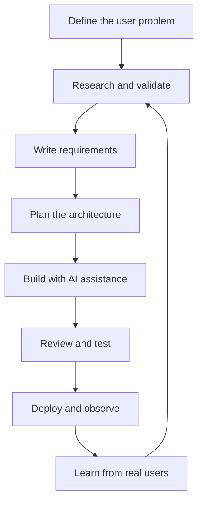



# Little About Vibe Coding

### From AI-generated code to products you understand, build, and improve.

  

**A practical, evolving knowledge base for AI-assisted software development and product building.**

[Ultimate Guide](docs/01-ultimate-vibe-coder-guide.md) ·
[Documentation Index](#-documentation-library) ·
[Product Projects](#-product-projects) ·
[Author](#-about-the-author)

---

## What is this repository?

Vibe coding makes it easier to move from an idea to a working prototype with AI assistance. But generating code is only one part of building a useful product.

This repository brings together practical guides, product-development principles, startup thinking, AI-quality practices, and prompts that help make AI-assisted building more deliberate.

The objective is not merely to generate more code. It is to develop the judgment to **define the right problem, evaluate AI output, understand trade-offs, validate ideas, and build products that serve real users.**

> Use AI to accelerate execution—not to outsource your understanding.

## Start here

### 01 · Ultimate Vibe Coder Guide

**[Read the complete guide →](docs/01-ultimate-vibe-coder-guide.md)**

The flagship guide in this repository. Start here for the broader framework, then use the focused resources below when working on a specific part of product development.

## 📚 Documentation Library

The links below point to Markdown files in this repository.

| Resource | What it covers |
|---|---|
| [Ultimate Vibe Coder Guide](docs/01-ultimate-vibe-coder-guide.md) | The flagship guide to AI-assisted building |
| [AI Quality Instructions](AI_QUALITY_INSTRUCTIONS.md) | Instructions and considerations for AI output quality |
| [AI Startup Builder's Field Manual](ai_startup_builders_field_manual.md) | Startup-building reference material |
| [Product Building & Business Strategy](ChatGPT%20Project%20Product%20Building%20%26%20Business%20Strategy.md) | Product and business strategy reference |
| [Core Product Development & Management Foundation](Core%20Product%20Development%20%26%20Management%20Foundation.md) | Product-development and management foundations |
| [Karpathy Guidelines](KARPATHY%20GUIDELINES.md) | A reference for AI-assisted development practices |
| [Principles and Strategies](Principles%20and%20Strategies.md) | Principles and strategy notes |
| [Sam Altman — Startup Validation Prompt](SAM%20ALTMAN%20-%20STARTUP%20VALIDATION%20PROMPT.md) | A startup-validation prompt resource |

Use these materials as working references. Adapt their ideas to the project, validate important claims, and verify generated code before relying on it.

## 🧭 A practical building workflow

### Principles worth keeping

- **Problem before technology:** establish who the product serves and what problem it solves.
- **Understand the output:** inspect generated code, data flows, dependencies, and security implications.
- **Verify, don't assume:** test behavior, edge cases, permissions, and failure paths.
- **Build in small increments:** keep changes reviewable and easier to debug.
- **Protect secrets:** never commit API keys, access tokens, passwords, or private credentials.
- **Measure real outcomes:** a successful build is not necessarily a useful product.
- **Keep learning:** document decisions, failures, and lessons that can improve the next iteration.

## 🧰 Tools and ecosystem

AI-assisted product development can involve several kinds of tools:

| Category | Examples |
|---|---|
| AI assistants and models | ChatGPT, Gemini, Grok, Ollama, Qwen |
| Frontend deployment | Vercel |
| Backend deployment | Render |
| Database and backend services | Supabase |
| Authentication | Clerk |
| Design and prototyping | Stitch, Figma |
| Research and automation | Manus, Agent Reach, Scrapling |
| Development workflows | gstack and other task-specific skills |

This is an illustrative ecosystem, not a claim that every tool is installed, connected, or used in every project. Choose tools based on the product's requirements, constraints, and risk profile.

## 🚀 Product Projects

These are the five product names in the author's portfolio.

1. **PAWPHILE** — A pet-health product project.
2. **TRUNPUS** — A product project in the portfolio.
3. **AEGON** — A product project in the portfolio.
4. **STOCKSEE** — A stock-analysis product project.
5. **AARAICHI** — An evolving project currently undergoing upgrades.

Project descriptions will be expanded as their verified scope, documentation, and implementation details are ready to share. Not every project or repository is necessarily public.

## 🗺️ Suggested learning path

1. **Foundations:** learn the product problem, user, and desired outcome.
2. **Planning:** write requirements, user flows, and acceptance criteria.
3. **Building:** use AI tools to implement small, understandable increments.
4. **Quality:** review, test, debug, and assess security.
5. **Deployment:** understand environments, databases, authentication, and observability.
6. **Validation:** gather feedback and measure whether the product solves the intended problem.
7. **Iteration:** improve the product using evidence, not assumptions.

## 🤝 Contributions and feedback

Found an error, broken link, or useful improvement? Open an issue or submit a pull request with a clear explanation of the change.

Useful contributions include:
- Corrections and clearer explanations.
- Reproducible examples and verified workflows.
- Better testing and security practices.
- Practical lessons from real AI-assisted projects.

Please avoid submitting secrets, private data, unverified claims, or copied material without appropriate permission and attribution.

## ⭐ Support the project

If this repository helps you learn or build something better, consider **starring the repository** and sharing it with other builders.

A star is useful feedback; the long-term goal is to earn attention through practical, accurate, and continuously improved resources.

## 👤 About the Author

**ESSAKKI RAJA T.**

Data Science engineering student interested in AI product building, product strategy, business analytics, decision science, and leadership.

- **GitHub:** [@ESSAKKI-RAJA](https://github.com/ESSAKKI-RAJA)
- **LinkedIn:** [Connect professionally](https://linkedin.com/in/essakki-raja-t)
- **Portfolio:** [Explore my work](https://essakki-portfolio-amber.vercel.app/)

---

**Build with curiosity. Verify with discipline. Improve with evidence.**

Maintained as a learning resource. Content and project details may evolve over time.

